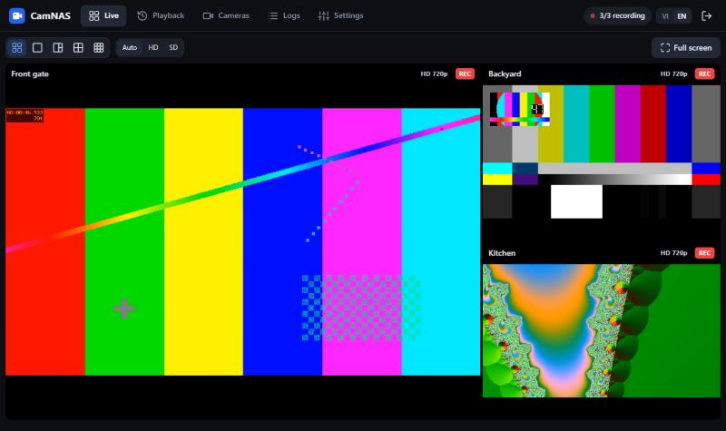
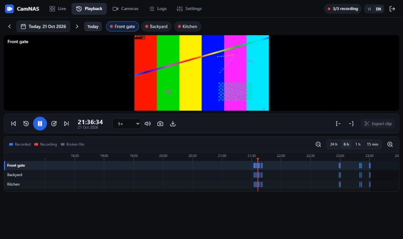
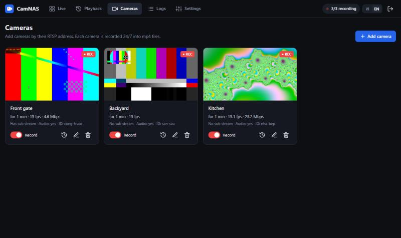
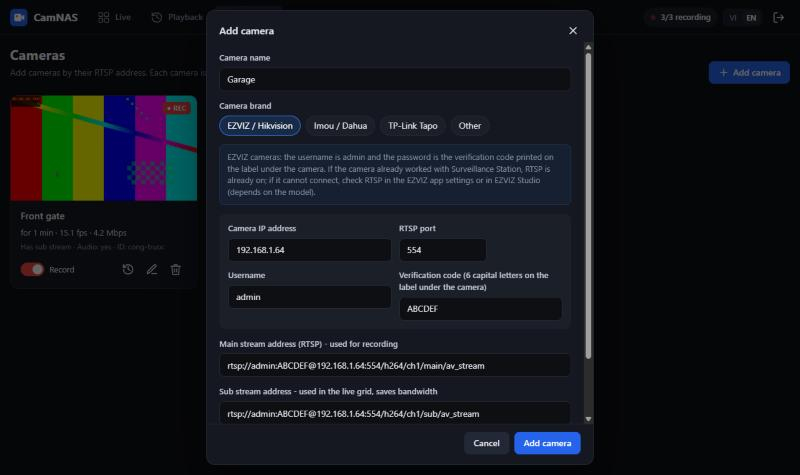

# CamNAS: free 24/7 camera recorder for Synology NAS (Surveillance Station alternative)

**English** | [Tiếng Việt](README.vi.md)

CamNAS is a free, self-hosted NVR that runs in Docker on your NAS. It records your IP cameras 24/7 straight to the NAS disks and gives you a web interface similar to Synology Surveillance Station, **without per-camera licenses**. Surveillance Station usually ships with only 2 free camera licenses; CamNAS records as many cameras as your NAS can handle.



| Timeline playback | Camera management |
|---|---|
|  |  |

## Features

- **Live view**: camera grid (1, 1 large + 2 small, 2×2, 3×3) with about 1 second of latency. Quality switch **Auto / HD / SD**. Double-click a camera to enlarge it. Snapshot, full screen and audio.
- **Playback**: 24-hour timeline with one row per camera. Drag, zoom with the mouse wheel, click anywhere to play. Segments play back to back. Speed from 0.5× to 16×. Mark start and end to **export an mp4 clip**.
- **Cameras**: add, edit, delete, turn recording on or off, test the connection. Presets for EZVIZ/Hikvision, Imou/Dahua and TP-Link Tapo, or enter any RTSP URL.
- **Automatic cleanup**: delete recordings older than N days, or the oldest recordings when the disk is nearly full.
- **Choose the recordings folder** from the web interface, with a folder browser for the NAS.
- **Event log**: camera disconnects and reconnects, cleanup runs and failed sign-ins.
- Works on phones.
- **English / Tiếng Việt** interface: use the `VI | EN` switch in the top bar or on the sign-in screen.

How it works: [go2rtc](https://github.com/AlexxIT/go2rtc) keeps **one** RTSP connection per camera. `ffmpeg` copies the video stream as is (no re-encoding, so it uses almost no CPU) and cuts it into mp4 files aligned to the clock. The browser's live view uses the same connection.

```
<recordings folder>/<camera-id>/2026-10-21/14-35-00.mp4
```

The files are plain mp4, so you can open them with VLC or File Station without CamNAS.

## Requirements

- A Synology NAS with **Container Manager** (DSM 7.2 or later; most "+" models and some ARM64 models). Any other NAS or Linux machine with Docker works too.
- Cameras with **RTSP**. If a camera already worked with Surveillance Station, it has RTSP.
- A **fixed IP** for each camera: in the router or modem that gives the cameras their addresses, reserve an IP (DHCP reservation) for each camera's MAC address.

## Install on Synology

1. **Download the code** (*Code → Download ZIP* on GitHub, or `git clone`) and copy it to the NAS, for example to `/volume1/docker/camnas`, using File Station or an SMB share. The folder should look like this:
   ```
   camnas/
     docker-compose.yml
     app/   (Dockerfile, requirements.txt, nvr/...)
     data/  (settings - CamNAS writes here)
   ```
   **You do not need to create any folders yourself.**
2. **Container Manager → Project → Create**:
   - Project name: `camnas`
   - Path: `/volume1/docker/camnas`
   - Source: *Use existing docker-compose.yml*
   - Click *Next*, then *Done*. The first build takes a few minutes.
3. Open **http://NAS-IP:8090** and sign in with the password `admin`. Then **change the password** in *Settings*.
4. **Recordings folder**: on the first run, recordings go to `/volume1/docker/camnas/recordings`. To change it, open **Settings → Recordings folder** and click **Browse…** to pick a folder on the NAS, or type a path such as `/volume1/camera`.
   - Pick a folder inside a DSM **shared folder** so you can browse it in File Station.
   - When you switch to another folder on the same volume, existing recordings are moved there instantly.
   - Do not enable Snapshots on the recordings folder: snapshots keep deleted data, so disk space is never freed.
5. Open **Cameras → Add camera**, choose the brand and enter the IP, username and password. For **EZVIZ**, the username is `admin` and the password is the **verification code** (6 capital letters on the label under the camera). Click **Test connection**; if the resolution shows up, click **Add camera**. Recording starts within seconds.

   

> If you used Surveillance Station before, stop it or remove the cameras from it once CamNAS works. Many cameras (EZVIZ in particular) limit the number of simultaneous RTSP streams, so two recorders connected at once can cause dropouts.

Set `TZ` in `docker-compose.yml` to your time zone (for example `Europe/Berlin` or `America/New_York`). The default is `Asia/Ho_Chi_Minh`.

### Install from the command line (SSH)

```bash
cd /volume1/docker/camnas && sudo docker compose up -d --build
```

### Disk access

To let you pick the recordings folder in the web interface, the container gets access to `/volume1`. CamNAS only writes to the folder you choose, and its automatic cleanup only touches camera folders it created itself (marked with a `.camnas` file). It never touches other data on the NAS.

- **Stricter access**: replace the `/volume1:/volume1` line in `docker-compose.yml` with one shared folder, for example `/volume1/camera:/volume1/camera`. You can then only pick folders inside it.
- **More than one volume**: uncomment the `/volume2:/volume2` line.

## RTSP addresses by brand

| Brand | Main stream | Sub stream |
|---|---|---|
| EZVIZ / Hikvision | `rtsp://admin:VERIFICATIONCODE@IP:554/h264/ch1/main/av_stream` | `.../h264/ch1/sub/av_stream` |
| Imou / Dahua | `rtsp://admin:PASSWORD@IP:554/cam/realmonitor?channel=1&subtype=0` | `...subtype=1` |
| TP-Link Tapo | `rtsp://USER:PASSWORD@IP:554/stream1` | `.../stream2` |

Choose the brand in the add-camera dialog and CamNAS builds these addresses for you.

**EZVIZ notes**:
- **Image/Video Encryption** must be **off** in the EZVIZ app; otherwise other software cannot decode the video.
- If *Test connection* says **"The camera refused the connection"**, RTSP may be off. To turn it on: connect your phone to the same Wi-Fi as the camera, open the EZVIZ app, go to *Profile → Settings → LAN Live View*, pick the camera, sign in with `admin` and the verification code, then open *Settings → Local Service Settings → RTSP*. Menu names vary a little between app versions.
- If the camera encodes **H.265**, CamNAS still records, but some browsers cannot play it (Firefox, or Chrome without hardware decoding). Switch the camera to **H.264** if that happens.
- Fill in the **sub stream**: small tiles in the grid use the lighter stream to save Wi-Fi bandwidth. Recording always uses the main stream.

## Storage

Rough estimate for 3 cameras:

| Camera resolution | Per camera/day | 3 cameras/day | 12 TB lasts |
|---|---|---|---|
| 1080p (~2 Mbps) | ~21 GB | ~65 GB | ~5–6 months |
| 2K/3MP (~3–4 Mbps) | ~35–45 GB | ~105–130 GB | ~3 months |

In **Settings** you can set:
- **Keep recordings for N days**: default 30. Use `0` to keep recordings until the disk is nearly full.
- **Maximum space for recordings**: useful if the disk also holds other data.
- **Always keep at least X GB free**: default 50 GB. When free space drops below this, the oldest files are deleted. Recordings from the last 24 hours are never deleted for lack of space.

Settings also shows the average space used per day and how many days the disk can hold.

## Remote access

**Do not** forward port 8090 to the internet. Two safe options:
- **Tailscale** (in Package Center): install it on the NAS and on your phone, then open `http://<NAS-Tailscale-IP>:8090`. This is the simplest and safest option.
- **DSM reverse proxy** (*Control Panel → Login Portal → Advanced → Reverse Proxy*) with a Let's Encrypt HTTPS certificate and a DDNS name. Enable WebSocket (*Custom Header → Create → WebSocket*) or live view will not work.

## Keyboard shortcuts

| Page | Keys |
|---|---|
| Live | `1`–`9`: enlarge that camera · `←`/`→`: next/previous camera · `Esc`: back to grid |
| Playback | `Space`: play/pause · `←`/`→`: back/forward 10 s (`Shift` for 1 min) · `PageUp`/`PageDown`: previous/next segment · `[` `]`: mark clip start/end · `+`/`-`: zoom timeline · `M`: mute |

## Updating and backup

- **Update**: download the new version and copy the `app/` folder over the old one. **Keep the `data/` folder.** Only copy `docker-compose.yml` when the new version changes it, and keep your own edits. In *Container Manager → Project → camnas*, click *Stop*, then *Action → Build*; clicking only *Start* keeps running the previously built version. Or run `docker compose up -d --build` again. Afterwards press Ctrl+F5 in the browser and check the version in *Settings → System*.
- **Backup**: the `data/` folder holds `config.json` (camera list, **camera passwords**, chosen recordings folder) and the event log. Keep it safe and do not share it.

## Troubleshooting

- Check the **Logs** page first; every camera connection error is logged there.
- **The project does not start: `Bind mount failed: '/volume1/...' does not exist`**: you are using an old `docker-compose.yml`. Copy the current one; it only mounts the project folder and `/volume1`, which always exist.
- **Log says "The recordings folder ... cannot be used"**: pick another folder in *Settings → Recordings folder*.
- **"Cannot get video from the camera"**: check whether the camera IP changed, the password is right, and (for EZVIZ) image encryption is off. Use *Test connection* in the edit-camera dialog.
- **Playback stays black**: usually the camera uses H.265 (see the EZVIZ notes).
- **Live view does not work but recording does**: try a recent Chrome, Edge or Safari.
- **Cameras and NAS on different networks** (for example cameras on the ISP modem's Wi-Fi and the NAS behind a second router): the NAS can still reach the cameras, as long as the two networks use different address ranges.
- Container logs: *Container Manager → Container → camnas → Log*, or `sudo docker logs camnas`.

## Running locally (development)

You need Python 3.11+, `ffmpeg`/`ffprobe` and the `go2rtc` binary ([releases](https://github.com/AlexxIT/go2rtc/releases)).

```bash
cd app && pip install -r requirements.txt && DATA_DIR=./_data RECORDINGS_DIR=./_rec GO2RTC_BIN=/path/to/go2rtc python -m nvr
```

The app runs at http://localhost:8080. Other environment variables: `FFMPEG`, `FFPROBE`, `HTTP_PORT`, `ADMIN_PASSWORD`, and `STORAGE_ROOTS` (allowed root folders for recordings, separated by `:`, or `;` on Windows).

UI translations live in `app/nvr/web/i18n.js`; server-side messages in `app/nvr/i18n.py`.

## Credits and license

- [go2rtc](https://github.com/AlexxIT/go2rtc) (MIT): receives the camera streams and serves live video to the browser. The CamNAS Docker image is built on the official go2rtc image.
- [FFmpeg](https://ffmpeg.org): recording and cutting the video files.
- CamNAS is released under the [MIT License](LICENSE).

CamNAS is not affiliated with Synology, EZVIZ or any camera manufacturer mentioned here; their names are used only to describe compatibility.
